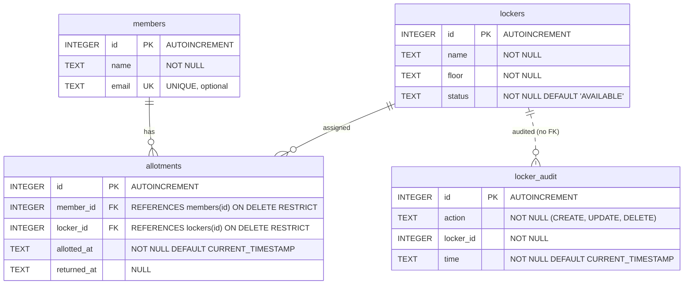

# FitNest Gym – Locker Management System Backend

FitNest Gym Locker Management System is a modular RESTful backend API designed to manage members, gym lockers, assignment tracking (allotments), and a transactionally secure locker mutation audit trail.

Built as a collaborative group assessment project adhering to strict software architecture, modular CommonJS conventions, and relational database constraints using Node.js, Express.js, and SQLite.

---

## 1. Project Overview & Features

FitNest Gym provides automated locker allocations across multiple gym floors. The backend ensures:
- **Member Registration & Management**: Unique email indexing, positive ID validation, and complete CRUD.
- **Locker Inventory & Floor Search**: Lockers categorized by floor with indexed search and status tracking (`AVAILABLE` vs occupied).
- **Relational Allotments**: Assignment tracking linking members to lockers with strict partial unique index constraints (at most one active locker per member and at most one active member per locker).
- **Transactional Audit Trail (Assignment Twist)**: Guaranteed atomic recording of all locker mutations (`CREATE`, `UPDATE`, `DELETE`) within synchronous SQLite transactions. Audit logs survive locker deletion.
- **Centralized Middleware**: Reusable input sanitization/validation, 404 route handling, and unified error responses preventing stack trace leakage.

---

## 2. Technology Stack

- **Runtime**: Node.js (v18+)
- **Web Framework**: Express.js (v4.21+)
- **Database Engine**: SQLite 3
- **Database Driver**: `better-sqlite3` (v11.8+)
- **Architecture**: CommonJS (`require` / `module.exports`), Modular Layered Pattern (Routes, Controllers, Services, Middleware, DB)
- **API Specification**: RESTful JSON over HTTP, Base URL: `/api`
- **Testing & Verification**: Postman (v2.1 Collection), Automated Node.js Test Suite

---

## 3. Team Members & Ownership Matrix

| Member | Branch | Primary Responsibilities |
|--------|--------|--------------------------|
| **Aravind** *(Lead)* | `feature/aravind-server` | Express application bootstrap (`src/app.js`, `src/server.js`), Common 404/Error middleware, Members APIs, Dependency/Package management |
| **Akshay** | `feature/akshay-database` | SQLite database connection (`src/db/database.js`), Idempotent schema initialization (`src/db/init.js`), Foreign key constraints & partial indexes |
| **Manvith** | `feature/manvith-lockers` | Locker CRUD routes/controllers (`src/routes/lockers.routes.js`), Audit route/controller, Transactional audit service (`src/services/lockerAudit.service.js`) |
| **Nevanesh** | `feature/nevanesh-validation` | Allotments JOIN controller/routes (`src/routes/allotments.routes.js`), Locker input validation middleware (`src/middleware/lockerValidation.js`), Floor-search service (`src/services/lockerSearch.js`) |
| **Aditya** | `feature/aditya-postman` | Comprehensive Postman collection & environment (`postman/`), Automated API test scripts, Documentation (`README.md`, `docs/contributions/aditya.md`) |

---

## 4. Architecture & Directory Contract

```text
Fitnest-gym-locker-system/
  src/
    app.js                              # Express app configuration & middleware pipeline
    server.js                           # Server entrypoint (initializes DB, binds port)
    db/
      database.js                       # Shared better-sqlite3 database connection
      init.js                           # Idempotent table & index migration runner
    routes/
      members.routes.js                 # /api/members router
      lockers.routes.js                 # /api/lockers router
      allotments.routes.js              # /api/allotments router
      audit.routes.js                   # /api/audit router
    controllers/
      members.controller.js             # Members business logic & positive ID validation
      lockers.controller.js             # Locker CRUD business logic
      allotments.controller.js          # Allotment 3-table relational JOIN logic
      audit.controller.js               # Audit log query logic
    middleware/
      notFound.js                       # 404 JSON fallback middleware
      errorHandler.js                   # Central error handler (catches SQLite errors, no stack traces)
      lockerValidation.js               # Name/Floor trimming & validation middleware
    services/
      lockerSearch.js                   # Floor-based parameterized querying service
      lockerAudit.service.js            # Atomic better-sqlite3 mutation & audit transactions
  data/                                 # Local SQLite database directory (git-ignored)
  postman/
    FitNest_Gym.postman_collection.json # Standardized Postman v2.1 collection
    FitNest_Gym.postman_environment.json# Postman environment configuration
  docs/
    contributions/                      # Individual member evidence documents
      aravind.md
      akshay.md
      manvith.md
      navanesh.md
      aditya.md
    INTEGRATION_AUDIT_REPORT.md        # Comprehensive multi-member code audit
    INTEGRATION_TEST_REPORT.md         # Full integration test suite report
  .gitignore                            # Ignores node_modules, data/*.db, logs, OS files
  package.json                          # Package manifest & npm scripts
  package-lock.json                     # Dependency lockfile
  README.md                             # Project documentation
```

---

## 5. Database Schema & Relational Design

The shared database connection explicitly enables foreign keys (`PRAGMA foreign_keys = ON;`) on startup. Database initialization is 100% idempotent via `initDatabase()`.



### Table Definitions

1. **`members`**
   - `id INTEGER PRIMARY KEY AUTOINCREMENT`
   - `name TEXT NOT NULL`
   - `email TEXT UNIQUE` *(optional)*

2. **`lockers`**
   - `id INTEGER PRIMARY KEY AUTOINCREMENT`
   - `name TEXT NOT NULL`
   - `floor TEXT NOT NULL`
   - `status TEXT NOT NULL DEFAULT 'AVAILABLE'`
   - *Index*: `idx_lockers_floor` on `lockers(floor)`.

3. **`allotments`**
   - `id INTEGER PRIMARY KEY AUTOINCREMENT`
   - `member_id INTEGER NOT NULL REFERENCES members(id) ON DELETE RESTRICT`
   - `locker_id INTEGER NOT NULL REFERENCES lockers(id) ON DELETE RESTRICT`
   - `allotted_at TEXT NOT NULL DEFAULT CURRENT_TIMESTAMP`
   - `returned_at TEXT NULL`
   - **Partial Unique Index 1**: `CREATE UNIQUE INDEX idx_allotments_active_locker ON allotments(locker_id) WHERE returned_at IS NULL;`  
     *(Guarantees at most one active allotment per locker).*
   - **Partial Unique Index 2**: `CREATE UNIQUE INDEX idx_allotments_active_member ON allotments(member_id) WHERE returned_at IS NULL;`  
     *(Guarantees at most one active allotment per member).*
   - **Performance Indexes**: `idx_allotments_member_id` and `idx_allotments_locker_id`.

4. **`locker_audit`**
   - `id INTEGER PRIMARY KEY AUTOINCREMENT`
   - `action TEXT NOT NULL` (`CREATE`, `UPDATE`, `DELETE`)
   - `locker_id INTEGER NOT NULL` *(intentionally omits foreign key so audit records survive locker deletion)*
   - `time TEXT NOT NULL DEFAULT CURRENT_TIMESTAMP`
   - *Index*: `idx_locker_audit_locker_id` on `locker_audit(locker_id)`.

---

## 6. API Endpoint Specification

All endpoints are prefixed with `/api`. Consistent error format: `{ "error": "Human-readable message" }`.

| Method | Endpoint | Description | Success Status | Error Statuses |
|--------|----------|-------------|----------------|----------------|
| **GET** | `/api/members` | List all members | `200 OK` | `500` |
| **GET** | `/api/members/:id` | Get single member by ID | `200 OK` | `400` (malformed ID), `404` (absent) |
| **POST** | `/api/members` | Create new member | `201 Created` | `400` (missing/invalid name), `409` (duplicate email) |
| **GET** | `/api/lockers` | List lockers (all or filtered by floor) | `200 OK` | `500` |
| **GET** | `/api/lockers?floor=Ground` | Filter lockers by floor | `200 OK` | `500` |
| **GET** | `/api/lockers/:id` | Get single locker by ID | `200 OK` | `400` (malformed ID), `404` (absent) |
| **POST** | `/api/lockers` | Create locker (+ atomic CREATE audit) | `201 Created` | `400` (validation), `500` |
| **PUT** | `/api/lockers/:id` | Update locker (+ atomic UPDATE audit) | `200 OK` | `400` (validation), `404` (absent) |
| **DELETE** | `/api/lockers/:id` | Delete locker (+ atomic DELETE audit) | `200 OK` | `400` (malformed ID), `404` (absent), `409` (referenced in allotments) |
| **GET** | `/api/allotments` | Joined allotment records (3-table JOIN) | `200 OK` | `500` |
| **GET** | `/api/audit` | Latest 10 locker audit entries (newest first) | `200 OK` | `500` |

---

## 7. Critical Audit Transaction & Assignment Requirements

### Transactional Atomicity Guarantee
Every locker mutation is paired synchronously with an audit row inside a single `db.transaction()` block:
- **CREATE**: Inserts locker → writes `CREATE` row with `lastInsertRowid` → commits. If either step throws, both are rolled back.
- **UPDATE**: Updates locker → checks row changed → writes `UPDATE` row → commits.
- **DELETE**: Validates existence → writes `DELETE` audit row → deletes locker row.
  - If the locker is referenced by existing allotment history, SQLite raises a foreign key violation (`ON DELETE RESTRICT`).
  - The transaction catches the error, triggers an automatic `ROLLBACK` (removing the orphaned audit row), and returns HTTP `409 Conflict`.
  - If unreferenced, deletion succeeds, and the `DELETE` audit row persists in `locker_audit`.
- **Audit Query Ordering**: `GET /api/audit` executes `ORDER BY id DESC LIMIT 10`, using the autoincrement ID as the strict insertion-order tie-breaker for same-second mutations.

---

## 8. Installation & Setup

### Prerequisites
- Node.js (version 18.0.0 or higher)
- npm (version 9.0.0 or higher)

### Installation Steps

```bash
# 1. Clone the repository
git clone https://github.com/Dark-Passenger-07/Fitnest-gym-locker-system.git
cd Fitnest-gym-locker-system

# 2. Install dependencies
npm install

# 3. Start the application
npm start

# For development with auto-reload:
npm run dev
```

The server initializes the SQLite schema in `data/fitnest.db` automatically and listens on `http://localhost:3000`.

---

## 9. Testing & Postman Verification

### Automated Integration Test Suite
Run the comprehensive multi-module automated test suite:

```bash
node test/integration.test.js
```

### Postman Test Suite Execution
1. Open Postman.
2. Click **Import** and select:
   - `postman/FitNest_Gym.postman_collection.json`
   - `postman/FitNest_Gym.postman_environment.json`
3. Ensure the active environment is set to **FitNest Gym Environment** (`baseUrl` = `http://localhost:3000`).
4. Execute the collection via **Run Collection** or via Newman:

```bash
npx newman run postman/FitNest_Gym.postman_collection.json -e postman/FitNest_Gym.postman_environment.json
```

### Mandatory 3-Step Audit Test Sequence
1. **TEST 1 – Add a Locker**: `POST /api/lockers` with `{"name": "Locker-Audit-01", "floor": "Ground"}` → Returns `201 Created`.
2. **TEST 2 – Update Same Locker**: `PUT /api/lockers/:id` with `{"name": "Locker-Audit-01-Updated", "floor": "First"}` → Returns `200 OK`.
3. **TEST 3 – Inspect Audit Trail**: `GET /api/audit` → Returns `200 OK`.
   - The top two entries for the test locker are ordered:
     1. `action: "UPDATE"`
     2. `action: "CREATE"`
4. **TEST 4 – Delete & Verify Survival**: `DELETE /api/lockers/:id` → Returns `200 OK`. A subsequent `GET /api/audit` confirms `action: "DELETE"` is recorded and persists permanently.
